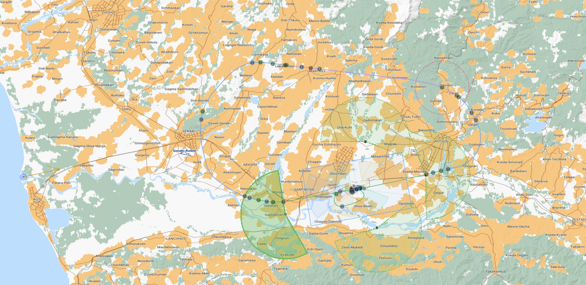
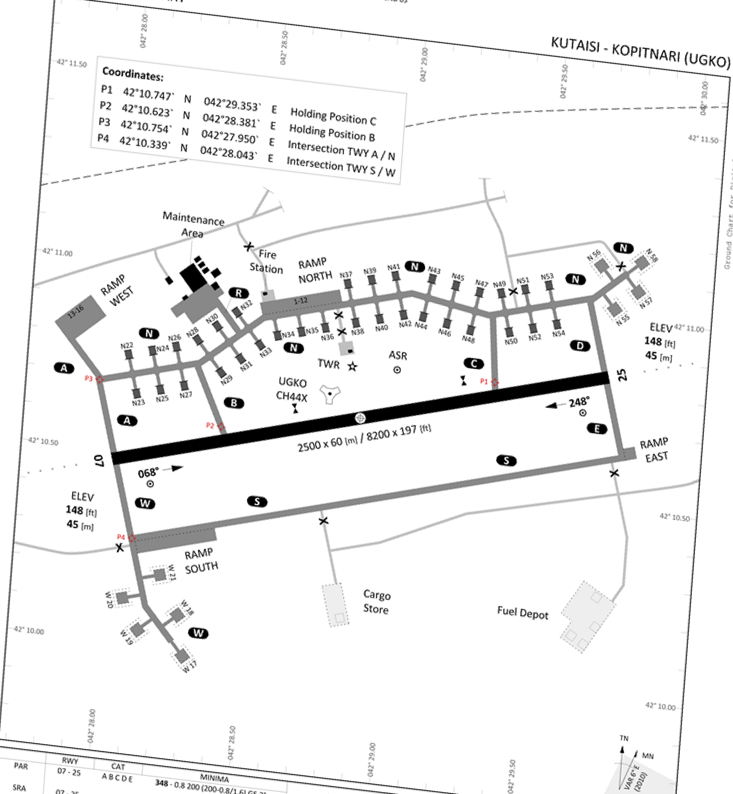

# A flight with Kutaisi ATC

This short guide follows Adder 1's flight on **29 October 2026**, using the
recorded Docker debrief and the Master Arms (MA) SOP flow. It shows what the
pilot says, what the controller does, and when an automatic frequency change
happens.

## The flight at a glance

```text
Spawn and start up
  → ATIS → Ground → clearance → taxi → hold short
  → Tower → takeoff → Control → Stingray
  → request RTB → Control → inbound join → Tower
  → runway in sight → overhead break → final → land
  → Ground → taxi to parking
```

The **phase** describes where the aircraft is in the flight. The **checked-in
agency** describes which radio frequency the pilot is currently using. A
handoff is complete only after ATC gives the frequency change and the pilot
checks in on the new agency.

The trainer follows these broad phases:

`Idle → Clearance → Taxi → Holding → Lineup → Takeoff → Airborne → Stingray → Inbound → Landing`

After landing, the phase returns to **Taxi** for the trip to parking. These are
trainer states that help ATC respond in context; the pilot does not need to say
the state names.

## Map overview

The overview screenshot you supplied is the visual anchor for this guide: it
shows the full route, entry/exit geometry, pattern area, and airport together.
It is included here:



The guide's map explanations are in
[Zones and automatic handoffs](zones-and-handoffs.md). The airport diagram
below is an additional local reference for taxiing, not a replacement for your
overview screenshot.

Kutaisi's airport diagram is included for the ground and runway portion:



## Walkthrough

Read [the flight walkthrough](flight-walkthrough.md) from top to bottom. The
dialog samples are from the actual debrief; spelling and punctuation are lightly
cleaned up for readability. Times are local to the debrief.

See the [pilot state machine](state-machine.md) for a visual summary of the
phases and the automatic handoff triggers.

## Source flight

Docker debrief: [flight-debrief.json](assets/flight-debrief.json)  
Pilot: Caveman · Callsign: Adder 1 · Runway: 07

The debrief records radio calls and aircraft positions. It does not record the
pilot's cold-start checklist or ATIS reception itself; those parts are explained
from the normal flow, with the first Ground call confirming information Kilo.

This was a one-ship flight, so **Adder 1** is both the flight and pilot
callsign; the transcript preserves what was logged. In any multi-ship flight
(two-, three-, four-ship, etc.), **Adder 1** is the flight callsign and the lead
uses their individual callsign, **Adder 11**, when calling an agency. Other
elements use **Adder 12**, **Adder 13**, and so on. The lead's element digit is
always **1** for any flight number (for example, Adder 21 is lead of Adder 2).
Flight check-ins and coordinated channel pushes still use the flight callsign.
The kneeboard cards show both cases.
