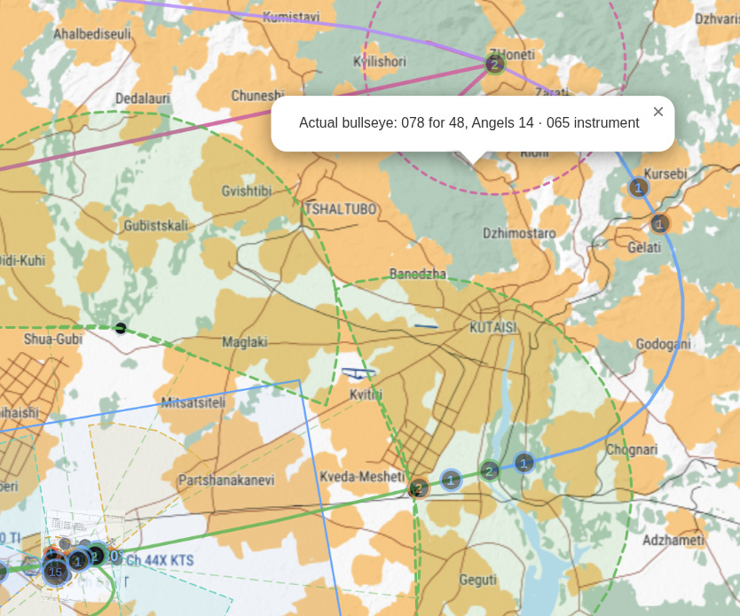
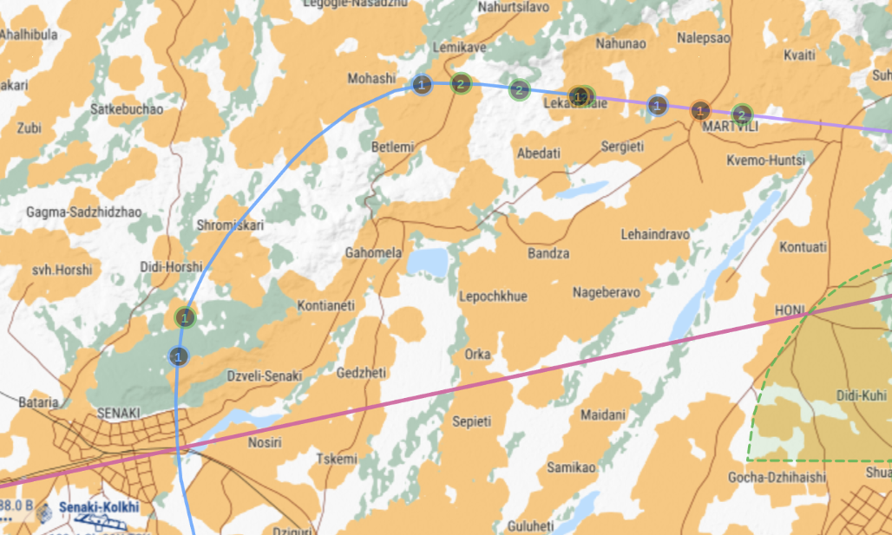
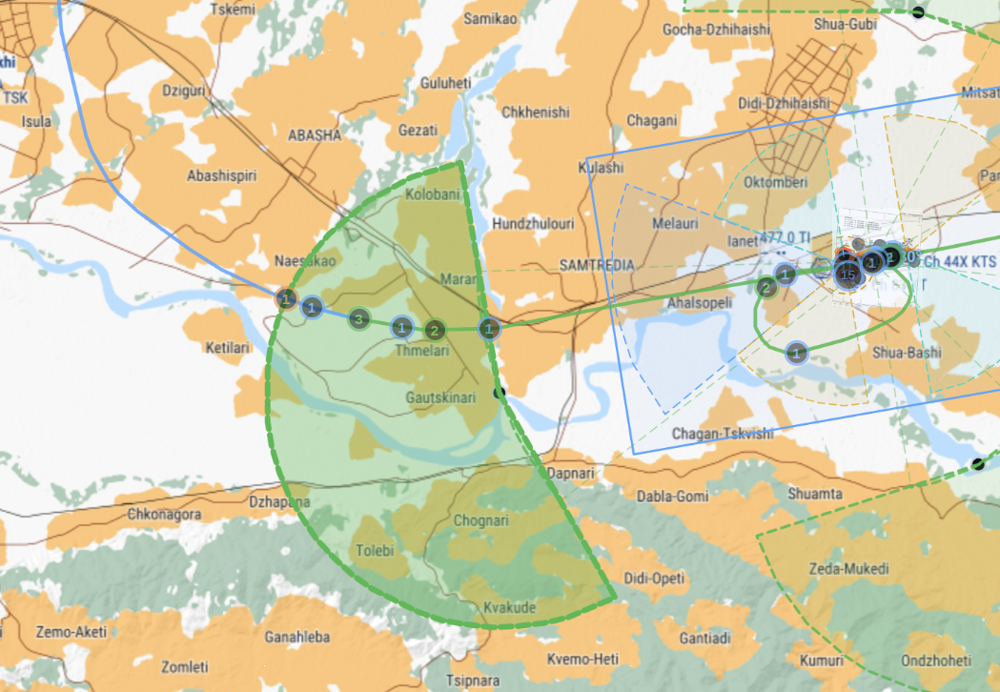

# Flight walkthrough: Adder 1

**Kutaisi · Runway 07 · 29 October 2026**

This is a compact, pilot-facing example based on one complete recorded flight.
Follow the calls in order; the explanations describe what the pilot should do
next.

## SPAWN AND START-UP

At **18:04:53**, the debrief begins tracking Adder 1 as idle. The pilot starts
the aircraft using the aircraft's normal cold-start procedure. Start-up actions
are not captured in this radio debrief.

Before calling Ground, listen to Kutaisi ATIS and note the information letter,
runway, wind, and QNH. In this flight the pilot later reported **information
Kilo**.

## GROUND

At **18:11:35**, the pilot checked in with Ground. They then gave their aircraft,
parking position, and ATIS information. Ground confirmed runway 07 and QNH
29.96. The pilot read both back.

```text
PILOT   Ground, Adder one.
ATC     Adder 1, Ground.
PILOT   Adder one, one ship Hornet, on Ramp South, with information Kilo.
ATC     Adder 1, Ground, runway 07 in use, QNH 2996.
PILOT   Runway 07 in use, QNH 2996, Adder one.
ATC     Readback correct, advise when ready for clearance.
```

When ready, ask to copy the departure clearance. The clearance gives the
departure exit and the altitude limit to maintain after takeoff.

```text
PILOT   Adder one, ready to copy clearance.
ATC     Adder 1, Ground, after departure Exit East, 1500 feet or below.
PILOT   After departure Exit East, 1500 feet or below, Adder one.
```

## TAXIING TO RWY

Request taxi after reading back the departure clearance. Taxi the assigned route
and stop short of the active runway. Once holding short, report that to Ground.

```text
PILOT   Adder one, requesting taxi.
ATC     Cleared taxi Whiskey and hold short runway 07.
PILOT   Cleared taxi Whiskey and hold short runway 07, Adder one.
PILOT   Adder one, holding short runway 07.
ATC     Contact Tower on channel 7.
PILOT   Adder one, channel seven, push.
```

The Ground-to-Tower change is prompted by the pilot's holding-short report.
Switch to Tower and make the first call there.

## TAKEOFF

Tower checks the aircraft's position, then gives line-up and takeoff
instructions. Read back each clearance.

```text
PILOT   Tower, Adder one, at runway 07, ready for departure.
ATC     Line up and wait runway 07.
PILOT   Line up and wait runway 07, Adder one.
ATC     Fly runway heading, cleared for takeoff runway 07.
PILOT   Fly runway heading, cleared for takeoff runway 07, Adder one.
PILOT   Adder one, wheels up.
```

Continue on the cleared runway heading and observe the departure exit and
altitude limit. Tower monitors the track and automatically calls the Control
handoff when the aircraft passes an outbound gate arc.

```text
ATC     Adder 1, Tower, contact Control on channel 8.
PILOT   Adder one, channel eight, push.
PILOT   Control, Adder one, at 1400 feet.
ATC     Radar contact, climb to Angels 15.
PILOT   Climbing to Angels 15, Adder one.
```

The pilot checks in with Control before receiving the climb. Control then
automatically hands the flight to Stingray when the aircraft reaches the
assigned climb altitude.



*Departure handoff: follow the route from Kutaisi to the assigned green dashed
exit arc (Exit East in this flight). Tower's automatic push to Control is
triggered when the aircraft crosses that arc. The popup also shows a later
bullseye check: calculated position 078 for 48 NM versus the pilot's reported
instrument bearing 065.*

## AIRBORNE

The initial Control check-in reports the aircraft's altitude. After the climb
clearance and readback, continue climbing. When Stingray is assigned, switch
frequencies and check in.

```text
ATC     Adder 1, Control, contact Stingray on channel 3.
PILOT   Adder one, channel three, push.
PILOT   Stingray, Adder one.
ATC     Adder 1, Stingray.
```

## STINGRAY — BULLSEYE PICTURE

Stingray is the tactical agency for the outbound part of the flight. A pilot
may report a Bullseye picture using bearing, range, altitude, and aspect. In this
flight the pilot reported bearing 065, range 49, Angels 14, as fragged. Stingray
acknowledged radar contact.

```text
PILOT   Adder one, marking Bulls, 065 for 49, Angels 14, as fragged.
ATC     Adder 1, Stingray, radar contact.
```

“As fragged” means the flight is following its briefed task. When ready to
return, request RTB on Stingray.

The outbound map above also shows a bullseye check. A pilot reports bearing,
range, and altitude from the fixed coalition reference point; Stingray compares
the call with the aircraft's actual position.

## RTB

At **18:20:12**, Adder 1 requested RTB. Stingray acknowledged, then automatically
pushed the flight to Control after a short pause. This flight was already within
the RTB handoff range.

```text
PILOT   Adder one, requesting RTB.
ATC     Adder 1, Stingray, copy, RTB.
ATC     Adder 1, Stingray, contact Control on channel 8.
PILOT   Adder one, channel eight, push.
PILOT   Kutaisi Control, Adder one.
ATC     Adder 1, Control.
```

If the automatic push has not happened by 25 NM, the pilot may request Control.
A missed push should not trap the flight.



*Return view: the track turns back toward Kutaisi from the northwest. Once
Control has the flight, report inbound position and altitude, then follow the
assigned heading and entry.*

## RETURN TO ENTRY

Tell Control the aircraft type and formation, that you are inbound, your
position, altitude, and lowest state if applicable. Control assigns a heading
and an entry for the active runway. Read the heading and entry back.

```text
PILOT   Adder one, one ship Hornet, inbound, 16 miles northwest of Kutaisi,
        Angels 14, lowest state 11.3.
ATC     Radar contact, turn left heading 167 to join via Entry West.
PILOT   Turn 167, join via Entry West, Adder one.
```

Follow the heading toward the assigned entry. Control issues descent in steps;
in this flight the intermediate clearance was 5000 feet, followed later by
1500 feet. Read each clearance back.

```text
ATC     Descend and maintain 5000 feet.
PILOT   Descend and maintain 5000 feet, Adder one.
...
ATC     Descend to 1500 feet.
PILOT   Descend 1500 feet, Adder one.
```

## INBOUND — ENTRY AND TOWER

Control automatically hands off to Tower when the aircraft enters the assigned
entry's lead-in zone while moving toward that entry. The entry arc and CTR
provide later fallbacks. After switching, report the assigned entry.

```text
ATC     Adder 1, Control, contact Tower on channel 7.
PILOT   Adder one, channel seven, push.
PILOT   Tower, Adder one, Entry West.
ATC     Adder 1, Tower, report runway in sight.
```

In this flight, the Entry West call was accepted in the Tower handoff zone,
before crossing the entry arc. Report “runway in sight” when you can see it.



*Inbound view: the large green shaded area is the Tower handoff lead-in zone
for the assigned entry. The automatic push occurs on entering that area while
approaching the entry; the entry arc and CTR are later fallback triggers.*

## OHB — OVERHEAD BREAK

After the runway-in-sight report, Tower clears the overhead break. Read back the
clearance, fly the assigned side of the pattern, and make the optional “in the
break” and “turning final” calls if useful.

```text
PILOT   Adder one, runway in sight.
ATC     Wind 030, 8 knots, cleared for right overhead break runway 07.
PILOT   Cleared for right overhead break runway 07, Adder one.
PILOT   Adder one, in the break.
PILOT   Adder one, turning final.
```

## LAND

When established on final, report “on final.” Tower checks the position and
issues the landing clearance. Read back the runway and clearance.

```text
PILOT   Adder one, on final.
ATC     Wind 030, 8 knots, runway 07, cleared to land.
PILOT   Runway 07, cleared to land, Adder one.
```

After landing, vacate the runway when safe. Tower automatically hands the pilot
to Ground after the runway is vacated.

## TAXI

Switch to Ground and check in. Then report runway vacated and request taxi to
parking. Ground assigns the parking area and route.

```text
ATC     Adder 1, Tower, contact Ground on channel 6.
PILOT   Adder one, channel six, push.
PILOT   Ground, Adder one.
ATC     Adder 1, Ground.
PILOT   Adder one, runway vacated, requesting taxi to parking.
ATC     Cleared taxi to Ramp North via Alpha November.
PILOT   Cleared taxi to Ramp North via Alpha November, Adder one.
```

This debrief ends after the parking-taxi readback. It does not show the aircraft
reaching the ramp or shutting down.
