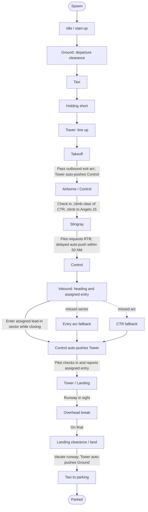

# Pilot state machine

GitHub renders this Mermaid flowchart directly in Markdown. It shows the
trainer's broad flight phases and the events that move the pilot through them.

## Two things to keep separate

- **Flight phase** is the aircraft's progress through the sortie: takeoff,
  airborne, inbound, landing, and so on.
- **Checked-in agency** is the radio controller the pilot is currently talking
  to. A handoff message creates a pending transfer; the pilot completes it by
  switching and checking in on the new frequency.

The aircraft can be physically airborne while still checked in with Tower. For
example, the trainer marks the departure phase as **Airborne** when it detects
the outbound exit crossing, and then Tower issues the Control handoff.

The **entry lead-in sector** is the early Control-to-Tower trigger. It is not
the entry arc: if the aircraft misses the sector, crossing the arc and entering
the CTR are later fallbacks. See [Zones and automatic handoffs](zones-and-handoffs.md)
for the map geometry.
