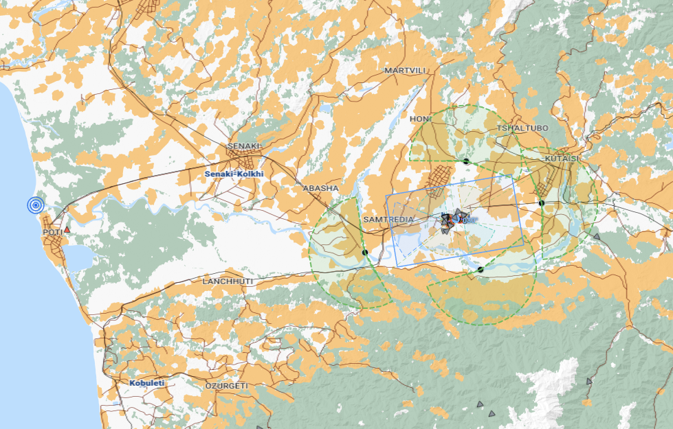
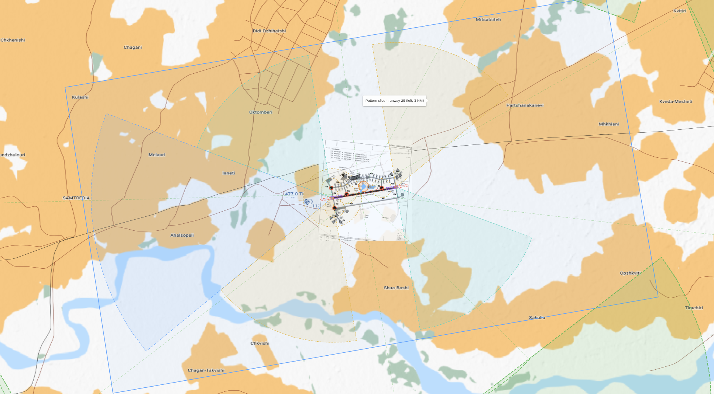

# Zones and automatic handoffs

The map draws the same geometry the trainer uses to check reports and trigger
some frequency changes. A line or shaded area is a guide to a check; it is not
a clearance by itself. Colors identify different kinds of geometry, while
their exact role depends on the shape and location.



*Overview: the blue outline marks the CTR; green dashed arcs mark entry and
exit gates, and green shaded sectors show the Tower handoff lead-ins. The blue
concentric target at the far left is the coalition bullseye reference point.
The active runway and assigned gate determine which checks apply.*

### Reading the map colors

- **Blue outline:** the Kutaisi Control Zone (CTR) boundary. The CTR extends
  from the surface to 1,500 ft AGL.
- **Green dashed arcs:** entry and exit gate arcs. The aircraft must cross the
  assigned arc for the gate-crossing event; passing nearby is not enough.
- **Green shaded sectors:** arrival Tower handoff lead-in zones. Only the
  assigned entry's sector is used for an inbound flight. Entering it on the
  approach triggers the early Control-to-Tower push.
- **Blue shaded wedge near the runway:** the final-approach check area. It is
  used to validate an “on final” report, not to issue landing clearance by
  itself.
- **Gold and turquoise pattern slices:** the left- and right-hand overhead
  pattern check areas. The selected runway determines which pattern applies.
- **Gold dashed circles:** holding/report check areas near the runway.

The map can show several configured checks at once. A dashed outline indicates
geometry; transparent fill helps distinguish areas where two checks overlap.

### Bullseye marker

The blue concentric target at the far left of the overview is the mission's
coalition bullseye: a fixed reference point used for position reports. It is
not an airfield, gate, or zone. A “marking bulls” or “bullseye” call gives the
aircraft's bearing and range from that point, usually followed by altitude
(for example, “marking bulls, zero six five for forty, angels fifteen”). The
when a bullseye call is present in a debrief, the viewer can draw its reported
bearing/range line so the call can be compared with the recorded aircraft
position.

## The main areas

### CTR

The Control Zone is the local airspace around Kutaisi. At Kutaisi it extends to
1500 feet above the airfield. The configured polygon is drawn on the map. On
departure, Control waits for the aircraft to be clear of the CTR before issuing
the climb. On arrival, entering the CTR is a late fallback for the Tower
handoff.

### Entry and exit gate arcs

Each entry or exit has a radial arc at the edge of the CTR. The assigned gate
depends on the active runway and the clearance. The trainer watches whether the
aircraft crosses the arc; merely being nearby or flying through a different
direction does not count as passing it.

- **Departure:** Tower automatically hands the aircraft to Control after it
  passes an outbound gate arc. The pilot does not have to say “passing exit” to
  trigger the handoff. If the pilot passes a different gate, the trainer can
  coach the deviation.
- **Arrival:** the entry arc is a fallback for the Control-to-Tower handoff.
  Tower can accept the assigned-entry report at the lead-in zone or later, so
  the pilot need not wait until the aircraft crosses the arc to check in.

### Tower handoff lead-in zone

This is the green shaded sector in front of the assigned arrival entry in the
overview image. It is **200 degrees wide** and extends **5 NM from the entry
point**, facing outward from the airfield. Only the assigned entry is active
for an inbound flight.

After Control has assigned the entry, the automatic Tower push fires when the
aircraft enters this sector while moving toward the entry. This gives the pilot
time to change frequency and report the entry before reaching the gate. If the
pilot misses the sector, crossing the entry arc or entering the CTR triggers a
later fallback handoff.

```text
Control assigns Entry West
        ↓
Aircraft approaches Entry West and enters its lead-in zone
        ↓
Control: contact Tower on channel 7
        ↓
Pilot switches, checks in, and reports Entry West
```

The green gate arc and the green lead-in sector are separate checks: the sector
is an early handoff area; the arc identifies the entry crossing.

### Overhead break and final checks

The overhead-break turn slices show the pattern geometry. The blue final-approach
sector shows the position corridor used when the pilot reports “on final.”
Tower checks that report against the aircraft's actual position and heading
before clearing it to land. The “runway in sight” report is a separate step: it
leads to the overhead-break clearance, not straight to landing.



*Airport view: the blue rectangle is the CTR boundary and the blue wedge is the
final-approach check area. Gold dashed circles show holding checks; the gold
pattern slice marks the left-hand pattern geometry (the turquoise slice marks
the right-hand side). The thin green dashed sectors and arcs are the entry
handoff and gate geometry. The runway itself is the long strip through the
airport diagram; the checks around it are separate from the runway clearance.*

## When the frequency changes

| From → To | What triggers it | Pilot's next action |
| --- | --- | --- |
| Ground → Tower | Pilot reports holding short; Ground issues the push | Switch to Tower and report ready for departure |
| Tower → Control | Aircraft passes a departure exit arc | Switch, then check in with Control and report altitude |
| Control → Stingray | Aircraft reaches the assigned climb altitude after Control check-in | Switch and check in with Stingray |
| Stingray → Control | Pilot requests RTB; after a short pause, auto-push occurs within 50 NM | Switch and check in with Control |
| Control → Tower | Aircraft approaches the assigned entry through its lead-in sector; entry-arc and CTR fallbacks remain | Switch and report the assigned entry |
| Tower → Ground | Aircraft vacates the runway | Switch to Ground and report runway vacated; Ground assigns a ramp and taxi route. Request a preferred ramp in the call if desired. |

The frequency-change message is not the same as a completed check-in. A normal
handoff is: controller gives the new channel → pilot acknowledges and switches
→ pilot calls the new agency. If a pilot misses a push, they can request the
agency they need; the trainer is designed to let the flow recover.
